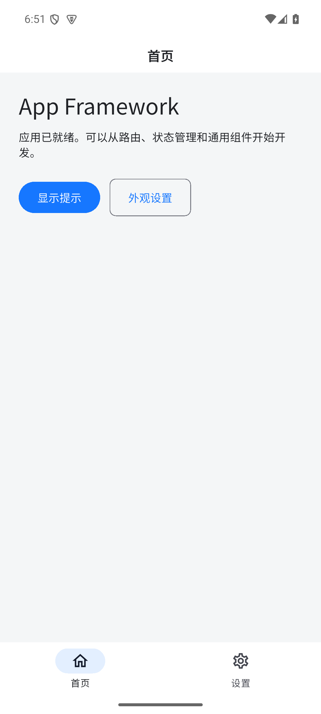
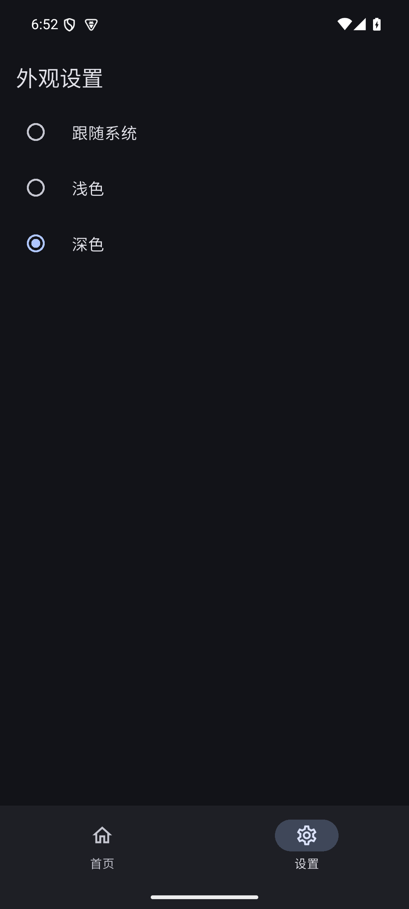

# Flutter App Framework

通用 Android / iOS APP 起始框架，基于 Flutter、Riverpod、GoRouter、Dio 和 Material 3。保留移动开发常用的初始化、导航、主题、网络、凭证、动作锁、分页和共享状态组件，作为不同新应用的基础工程。

只有 Android / iOS 工程，没有 Flutter Web 或桌面端入口。默认首页、外观设置和示例动作本地运行，无需账号或后端；没有业务模型、接口、生产域名、支付/客服/推送 SDK、原应用标识或发布凭证。

## 运行截图

2026-11-03 采集，源码版本 `dc9364a` 构建为 Android APK 后，在 Android 模拟器（API 35）中实际运行。下方展示 Android APP 界面，iOS 运行情况需在对应环境单独验证。

| APP 首页与导航 | 外观设置与深色主题 |
| --- | --- |
|  |  |

首页展示路由入口与通用提示能力；外观设置支持跟随系统、浅色和深色，页面共享统一主题状态。

## 环境要求

| 项目 | 要求与已验证范围 |
| --- | --- |
| Flutter / Dart | 已验证 Flutter 3.32.8 / Dart 3.8.1；依赖由 pubspec.lock 固定 |
| Android | minSdk 23（Android 6.0）；需要 Android SDK、兼容 JDK 和 Flutter Android 工具链 |
| iOS | macOS、Xcode、可用 iOS 设备平台、CocoaPods；真机运行还需要签名与设备授权 |
| 其它 | Material 字体与 NotoSansSC 中文字体随仓库保留，字体许可证见 assets/fonts/OFL.txt |

升级 Flutter 或原生工具链前，需同时检查插件兼容性与锁文件；当前仓库不承诺未验证的新 SDK 组合。

## 快速开始

```sh
git clone https://github.com/wn228664/flutter-app-framework.git
cd flutter-app-framework
./tool/flutterw pub get
./tool/flutterw devices
./tool/flutterw run
```

`tool/flutterw` 按顺序查找 FLUTTER_BIN、PATH 中的 flutter、本机 android/local.properties 中的 SDK 路径。新机器建议将 Flutter 加入 PATH，或显式指定：

```sh
FLUTTER_BIN=/path/to/flutter/bin/flutter ./tool/flutterw pub get
FLUTTER_BIN=/path/to/flutter/bin/flutter ./tool/flutterw run -d DEVICE_ID
```

多个设备时，将 DEVICE_ID 替换为 devices 输出中的目标。android/local.properties、Pods、.dart_tool、构建缓存等由本机工具生成，不从其它机器复制。

## 命令与产物

先 pub get，再执行使用 --no-pub 的验证和构建命令。

```sh
make run            # 启动应用
make verify         # analyze --no-pub → test --no-pub
make build-android  # Android 调试包（使用调试签名）
make build-ios      # iOS Debug、不进行 codesign，仍需要可用 Xcode 平台
```

等价的 Flutter 命令：

```sh
./tool/flutterw analyze --no-pub
./tool/flutterw test --no-pub
./tool/flutterw build apk --debug --no-pub
./tool/flutterw build ios --debug --no-codesign --no-pub
```

Android 调试包输出 `build/app/outputs/flutter-apk/app-debug.apk`。Debug 包与不签名 iOS 构建都不是商店分发交付；Release 配置、应用标识、图标、签名和商店资料由新应用自行配置。

## 能力与目录

```text
.
├── lib/
│   ├── main.dart            # Binding、配置校验、偏好初始化、ProviderScope
│   ├── app/                 # 根应用、Provider、GoRouter、独立导航分支
│   ├── core/
│   │   ├── config/          # 编译参数与校验
│   │   ├── network/         # Dio、异常、取消、会话代次
│   │   ├── storage/         # TokenStore 与系统安全存储边界
│   │   ├── state/           # 动作锁、主题控制器
│   │   └── models/          # JSON 类型、分页与主题模型
│   ├── shared/
│   │   ├── theme/           # 亮/暗 Material 主题和 token
│   │   └── widgets/         # 异步状态、分页、网络、头像、顶部消息、WebView
│   └── features/            # 本地首页与外观设置示例
├── android/ / ios/          # 独立原生壳
├── assets/fonts/            # 中文字体和 OFL 许可证
├── test/                    # 核心逻辑与 widget 回归
├── tool/flutterw            # SDK 查找入口
├── Makefile
└── docs/COMMON_COMPONENTS.md
```

依赖方向为页面 → Provider / Controller → ApiClient / TokenStore。共享组件消费参数和回调，不导入具体业务服务。StatefulShellRoute.indexedStack 保留首页与外观设置的独立导航状态；Provider 负责依赖注入及 ApiClient 关闭。

## 配置标题与 API

```sh
./tool/flutterw run \
  --dart-define=APP_TITLE='My App' \
  --dart-define=API_BASE_URL=https://api.example.com
```

| 参数 | 默认 | 行为 |
| --- | --- | --- |
| APP_TITLE | App Framework | 设置 Flutter 内部应用标题 |
| API_BASE_URL | 空 | 空值允许启动；发请求时抛 API_NOT_CONFIGURED。非空值必须为绝对 HTTP(S) URL |

编译参数需要重新运行/构建；APP_TITLE 不修改 Android / iOS 桌面显示名。桌面名分别在 AndroidManifest.xml 和 Info.plist 配置。

原生标识为 Android `dev.framework.flutter_app_framework`、iOS `dev.framework.flutterAppFramework`。作为新应用使用时同步修改 namespace/applicationId、MainActivity 包路径、iOS Bundle Identifier、显示名与签名设置，不只替换 Flutter 标题。

## 网络、凭证与并发

- ApiClient.request 接收相对 path、method、query、data、decode 和 CancelToken；禁止绝对/协议相对/非法路径。成功响应原样交给 decode，不内置业务信封或成功码。
- authenticated=false 不读取凭证、不执行 401 清理。认证请求核对凭证 revision，旧成功不进入 decode，旧 401 不清理新会话。
- TokenStore 写入串行化、读取等待已发起的修改；write/clear 发起即递增 revision。失败不回退明文或旧凭证，后续成功写入可恢复。
- 默认 SecureTokenStorage 在 Android 使用 Keystore 保护的加密偏好，在 iOS 使用应用 Keychain；TokenStorage 可注入测试后端。SharedPreferences 只保存非敏感主题偏好。
- Android 关闭备份以避免恢复缺少原设备密钥的加密数据。没有复制任何原应用凭证键、历史数据或业务迁移。
- ActionLockController 按动作键防重，失败释放锁；重复进入返回 null。调用方仍需负责请求取消、销毁后停止写 UI 和服务端幂等。

```dart
final cancel = CancelToken();
final payload = await api.request<Map<String, Object?>>(
  '/items',
  cancelToken: cancel,
  decode: (value) => Map<String, Object?>.from(value as Map),
);
// owner 销毁或新请求替代旧请求时 cancel.cancel()。
```

示例中的 api 和业务数据由新项目提供；默认首页不发送上述请求。常用错误码为 API_NOT_CONFIGURED、INVALID_PATH、SESSION_CHANGED、CANCELLED、HTTP_ERROR。

## 常用组件

| 封装 | 能力与调用方责任 |
| --- | --- |
| AsyncValueView / EmptyState / ErrorState | loading、错误、重试、数据、空态；支持自定义错误/空判断；长内容在自身区域滚动 |
| AppLoadingIndicator | 通用加载与紧凑分页加载，带语义标签 |
| PaginationScrollListener / PaginationFooter | 当前竖向容器的触底检测、同帧合并、loading/error/end 展示；onLoadMore 必须同步更新 isLoading |
| NetworkStatusOverlay | 连接提示、离线恢复刷新、异步刷新防重/失败反馈，保留 child 状态；连接类型不保证 API 可达 |
| UserAvatar | HTTP(S) 缓存头像、JPEG/PNG Data URL，非法/失败时回退主题色默认头像 |
| showTopMessage | 最新消息替换、计时器代次隔离、常驻提示和操作；长正文在受限区域内部滚动 |
| AppWebView | HTTP(S)、默认关闭 JavaScript、默认同源导航、显式 allowedHosts、进度、主文档错误与重试；旧配置事件失效 |

WebView 的白名单更新传入新 Set；组件需要有限高度。它使用 webview_flutter，未包含上传、下载、支付、登录或原生业务 Bridge。另一个 H5 仓库的 InAppWebView callHandler 不会自动与该组件互通，需要新宿主明确接入协议。

完整公开契约、失败语义与生命周期责任见 [APP 通用封装](docs/COMMON_COMPONENTS.md)。

## 作为新应用使用

1. 创建独立工程并更换名称、应用标识、图标、主题和签名。
2. 在 lib/features/ 按功能组织页面、controller 和服务适配；在 app/router.dart 注册导航。
3. 通过 Provider 注入配置、网络与存储，按真实后端文档实现解码和业务成功判断。
4. 使用现有动作锁、取消、分页、空/错误/加载态，保持共享层不导入具体功能模块。
5. 先验证分析与测试，再在实际 Android / iOS 设备验证权限、WebView、存储与新增流程。

## 验证记录与已知限制

2026-11-04 本地续跑验收（上方截图仍保留 11 月 3 日原始采集说明）：

| 检查 | 结果 |
| --- | --- |
| 依赖 | 离线 enforce-lockfile 解析成功；本次复核未升级依赖，凭证后端固定为 flutter_secure_storage 9.2.4 |
| 静态与回归 | 分析无问题，28 项测试通过；覆盖会话、动作锁、存储失败恢复、主题写入顺序、网络竞态、分页、窄屏/横屏大字号、头像、消息、WebView |
| Android | 本轮 Debug APK 构建、API 35 ARM64 模拟器安装与启动成功；首页、外观设置、主题切换、冷重启持久化和顶部消息已核验，未替代真机全交互 |
| iOS | Pod 安装成功；SDK 列表包含 iOS 26.0，但 Xcode 仍将设备目的地标为平台未安装，且无模拟器运行时；编译和运行未通过 |

iOS 26.0 是当次验收主机的环境错误，不是本框架要求 iOS 最低版本为 26。iOS 编译、实际设备 Keychain/Keystore 行为、原生权限及未来真实服务流程，需要在对应环境继续验证。Dart、原生壳与配置的逐项注释、语义对比和格式例外见 [注释范围与验证边界](docs/ANNOTATION_SCOPE.md)。

- **Flutter 未找到**：将 SDK 加入 PATH 或设置 FLUTTER_BIN。
- **API_NOT_CONFIGURED**：默认允许空服务地址；需要联网时传入有效 API_BASE_URL。
- **iOS 无可用目的地**：检查 Xcode 平台组件、命令行工具选择和设备，而不是根据 Android 成功推断 iOS 成功。
- **首页无真实数据**：默认页面是通用验证入口，框架没有配置业务服务。

仓库保留源码、测试、说明、字体许可证、原生工程和锁文件；不提交本机 SDK 路径、依赖缓存、安装包、签名凭证或日志。
